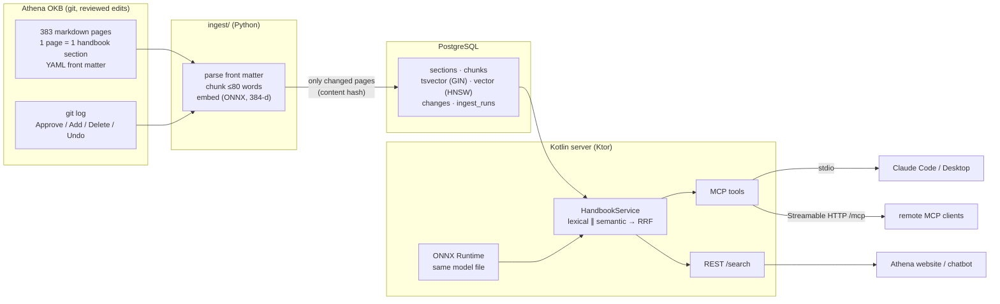

# athena-mcp-kt

A Kotlin back-end that serves CMKL University's handbook knowledge base to LLM tools over the
**Model Context Protocol**, with **hybrid retrieval** (Postgres full-text search + pgvector, fused
with reciprocal rank fusion) and a **citation on every answer**.

It is a new consumer of [Athena](#background), the reviewed single source of truth for CMKL's
student handbooks: Claude Code, Claude Desktop or any MCP client can ask "how much notice do I give
before returning from leave?" and get the passage, the handbook, the section and the file it came
from. A REST endpoint exposes the same search to Athena's website and chatbot.

**Stack:** Kotlin 2.4 · Ktor 3 · MCP Kotlin SDK 0.16 (stdio + Streamable HTTP) · PostgreSQL + pgvector ·
ONNX Runtime (in-process embeddings on the JVM) · Python ingest job (uv) · JUnit 5 + Testcontainers ·
GitHub Actions · Docker

## Results

Retrieval eval on the **30 real CMKL questions from Athena's Week 3 test** plus 6 Thai rewrites
(35 scored; 1 question has no answer in the knowledge base). A hit@k means a page that answers the
question is in the top k sections. Script: [`eval/run_eval.py`](eval/run_eval.py); full table:
[`eval/results.md`](eval/results.md).

| Retrieval (all 35 questions) | hit@1 | hit@3 | hit@5 | hit@10 | MRR@10 | p50 latency* |
|---|---|---|---|---|---|---|
| Lexical only (Postgres FTS) | 40% | 66% | 74% | 83% | 0.54 | 13 ms |
| Semantic only (pgvector, multilingual MiniLM) | 54% | 71% | 86% | 97% | 0.66 | 53 ms |
| **Hybrid (RRF)** | **60%** | **77%** | **91%** | **94%** | **0.71** | 58 ms |
| Hybrid + programme filter | 66% | 86% | 91% | 94% | 0.76 | 37 ms |

\* end to end through `GET /search` on a laptop (Apple Silicon), including embedding the query.

- **Hybrid beats either retriever alone** where it matters for an answer: hit@1 60% vs 40% / 54%,
  hit@5 91% vs 74% / 86%. On the 29 English questions, hybrid hit@5 is **97%** (28 of 29).
- **The programme filter** (a student says which programme they're in) lifts hit@3 from 77% to 86%:
  the three handbooks share section titles with different rules.
- **Week 3's retrieval misses are fixed.** Athena's earlier LLM Wiki test picked pages from titles and
  missed three questions on retrieval. Two are now found (the IMB petition route at rank 1, the
  36-unit rule at rank 2); the third (tuition refunds) is not in the knowledge base at all, so the
  right answer is "the handbooks don't say".
- **Thai questions work through meaning, not words**: Postgres can't segment Thai, so lexical search
  finds 3 of 6; semantic search finds 5 of 6 by hit@5 and all 6 by hit@10. Hybrid gets 4 of 6 in
  the top 5: on Thai, lexical noise (English codes inside the Thai question) can push the right page
  down. Language-aware fusion weights are a next step.
- **Known miss:** question 6 (instalment plans) is answered only by a finance committee decision in
  the minutes, and general tuition pages outrank it. That is what [Exercise 3](EXERCISES.md)'s
  `find_decisions` tool is for.

**Claude Code using it** (`claude -p` with this server over stdio, Sonnet): asked about the
notice period for returning from leave in the M.S. in ECE, it answered from the ECE handbook section,
cited it, found the committee decision that changes it, and flagged that the minutes' effective date
looked mis-transcribed.

## Architecture



- **Python writes, Kotlin reads.** The ingest job (offline, incremental) parses pages, splits them into
  passages that fit the embedding model's 128-token window, embeds them and writes one transaction.
  The Kotlin server only reads (its connection pool is read-only).
- **Both sides run the same `.onnx` file.** The server tokenises and embeds the query in-process with
  ONNX Runtime and HF tokenizers (via DJL), so no Python or model server is needed at query time.
  A [parity test](src/test/kotlin/athena/embed/OnnxParityTest.kt) checks Kotlin and Python vectors
  agree (cosine > 0.999).
- **Hybrid search.** Lexical and semantic retrieval run concurrently (coroutines), each returns 50
  chunks, and [reciprocal rank fusion](src/main/kotlin/athena/search/Fusion.kt) merges them by rank, so
  the two scores' different scales don't matter. Results are collapsed to the best passage per section.
- **Every result carries its source:** handbook (with the source PDF), section, OKB file path and the
  date the page was last updated. The change log comes from the OKB's git history, where Athena
  commits each approved edit.

### MCP tools

| Tool | What it does |
|---|---|
| `search_handbook(query, programme?, top_k?, mode?)` | Hybrid search; passages with citations, as text for the model and as `structuredContent` JSON |
| `get_section(id)` | The full section with its citation; suggests close ids when it misses |
| `list_programmes()` | Programme codes, names and section counts |
| `recent_changes(since?, programme?, limit?)` | Approved edits from the OKB change log, newest first |

All tools are annotated read-only. Bad input comes back as a tool error the model can read and fix
(`isError: true`), never a protocol error. The server also sends instructions telling the model to
cite and to check committee decisions. A [Claude Skill](skills/cmkl-handbook/SKILL.md) teaches Claude
when and how to use the tools.

### REST

| Endpoint | |
|---|---|
| `GET /search?q=…&programme=ece-ms&k=5&mode=hybrid` | Same as `search_handbook`, as JSON |
| `GET /programmes` | Programme list |
| `GET /health` | Section / chunk counts, whether semantic search is on, OKB commit of the last ingest |
| `POST/GET/DELETE /mcp` | MCP over Streamable HTTP |

## Run it

Prerequisites: JDK 21, PostgreSQL with pgvector, [uv](https://docs.astral.sh/uv/), and a copy of the
Athena OKB (for example `CMKL-Chatbot/base-current`). On macOS:
`brew install openjdk@21 postgresql@18 pgvector uv`.

```bash
# 1. Database
createdb athena

# 2. Embedding model (~120 MB, once) and ingest
cd ingest
uv run athena-ingest download-model
uv run athena-ingest run --okb ~/Developer/obscura-simple-prototype/CMKL-Chatbot/base-current
#   {"sections": 383, "chunks": 1405, "embedded": 1405, ...}  ~25 s; re-runs only redo changed pages
cd ..

# 3. Build and run
export JAVA_HOME=/opt/homebrew/opt/openjdk@21
./gradlew installDist
build/install/athena-mcp/bin/athena-mcp serve          # http://localhost:8080
curl 'localhost:8080/search?q=leave+of+absence+notice&programme=ece-ms&k=3'
```

`DATABASE_URL` (default `postgresql://localhost:5432/athena`), `ATHENA_MODEL_DIR` (default
`~/.cache/athena-mcp/models/paraphrase-multilingual-MiniLM-L12-v2`) and `PORT` configure both sides.
Without the model, ingest with `--no-embed` and the server falls back to lexical search and says so.

### Connect Claude Code

```bash
claude mcp add athena -e JAVA_HOME=/opt/homebrew/opt/openjdk@21 \
  -e DATABASE_URL=postgresql://localhost:5432/athena \
  -- "$PWD/build/install/athena-mcp/bin/athena-mcp" stdio
# or, with the HTTP server running:
claude mcp add --transport http athena http://localhost:8080/mcp
```

Copy [`skills/cmkl-handbook`](skills/cmkl-handbook) into `~/.claude/skills/` to add the Skill.

**Claude Desktop** (`claude_desktop_config.json`):

```json
{
  "mcpServers": {
    "athena": {
      "command": "/absolute/path/to/athena-mcp-kt/build/install/athena-mcp/bin/athena-mcp",
      "args": ["stdio"],
      "env": {
        "JAVA_HOME": "/opt/homebrew/opt/openjdk@21",
        "DATABASE_URL": "postgresql://localhost:5432/athena"
      }
    }
  }
}
```

### Docker

```bash
docker compose up -d db
docker compose run --rm ingest run --okb /okb/okb-mini --no-embed      # synthetic fixture
# or the real OKB: mount the git repo that holds it, so the change log can be read
OKB_REPO=~/Developer/obscura-simple-prototype/CMKL-Chatbot docker compose run --rm ingest run --okb /okb/base-current
docker compose up -d app
```

## Tests and CI

```bash
./gradlew test                    # Kotlin: 45 tests (7 are the disabled exercises)
cd ingest && uv run pytest        # Python: 16 tests
python3 eval/run_eval.py          # retrieval eval against a running server
```

- **Unit:** config parsing, RRF maths, mean pooling / normalisation, the service's fallbacks and
  validation (against an in-memory fake store).
- **MCP:** a real MCP client talks to the server over the SDK's in-memory `ChannelTransport`: tool
  schemas, annotations, citations, structured output, error results.
- **HTTP:** Ktor's `testApplication` for `/search`, `/health`, `/programmes`.
- **Integration:** the real SQL (FTS, pgvector, programme filter, change log) against Postgres with
  pgvector, started by **Testcontainers** in CI or pointed at a local test database with
  `ATHENA_TEST_DATABASE_URL=postgresql://localhost:5432/athena_test`.
- **Parity:** Kotlin vs Python embeddings (runs where the model is downloaded).

[GitHub Actions](.github/workflows/ci.yml) runs the Kotlin build with Testcontainers, the Python
tests, an end-to-end job (ingest the fixture OKB into a pgvector service container, then check
`/search` and a raw JSON-RPC session over stdio), and builds both Docker images.

## Design decisions

- **Postgres + pgvector, not SQLite + FTS5.** One database does both retrievers, filters and joins in
  SQL, and is what production services use. SQLite would have been lighter, but would need a separate
  vector extension and wouldn't exercise a real RDBMS with Testcontainers.
- **OR full-text queries.** `plainto_tsquery` ANDs every word, so a natural question matches nothing;
  the store ORs the question's stems and lets `ts_rank_cd` (title > heading > body weights) rank.
- **RRF instead of score blending** (k = 60, no tuning): ranks are comparable across retrievers, scores
  aren't.
- **Chunks of ≤80 words, prefixed with the section title**, because the multilingual MiniLM model reads
  128 tokens and silently drops the rest.
- **int8 ONNX model (118 MB instead of 470 MB)** and **one text per model run**: the quantised model
  scales activations per input tensor, so padded batches shift vectors (cosine 0.992–0.997). The
  parity test caught it.
- **Programme filter = the programme's pages + university-wide pages + minutes that list it** (from the
  pages' `applies_to`), so an M.S. in ECE question never gets the B.Eng. rule.
- **Degrade, don't fail:** no model → lexical search with a note; database down → a readable tool error;
  the server still starts.
- **stdio hygiene:** stdout carries the protocol, so logs go to stderr and `System.out` is redirected
  in stdio mode (the SDK's logging library prints a banner otherwise).

## Limitations and next steps

- Thai-heavy pages are chunked by whitespace, which Thai doesn't use, so a long Thai paragraph can
  exceed the model's window (only 3 of 383 pages contain Thai).
- Committee decisions are retrieved as text, not as a register with effective dates → `find_decisions`
  ([Exercise 3](EXERCISES.md)) and date-aware answers.
- A reranker (cross-encoder) over the top 20 would likely lift hit@1; the eval is there to prove it.
- `recent_changes` reads the OKB's git history at ingest time; a webhook from Athena on each approval
  would keep it live.

## Background

Athena (Fall 2026, URD-301) is a reviewed knowledge base for CMKL's handbooks: staff edit pages,
reviewers approve them in a FastAPI portal, every approval is a git commit, and a LaTeX pipeline
builds the handbooks from it. A RAG chatbot answers student questions from it. This server makes the
same reviewed content available to any MCP client, with sources.

## Repository layout

```
src/main/kotlin/athena/   config · domain · db · search (store, fusion, service) · embed · mcp · http · Main.kt
src/test/kotlin/athena/   unit, MCP, HTTP, integration, parity, exercises/
ingest/                   Python ingest job (uv project) + tests
db/schema.sql             shared schema (written by Python, read by Kotlin)
eval/                     questions.jsonl, run_eval.py, results.md
skills/cmkl-handbook/     Claude Skill
fixtures/okb-mini/        synthetic OKB for tests (no real handbook content in this repo)
```

[LEARNING.md](LEARNING.md) maps the Kotlin concepts used, [EXERCISES.md](EXERCISES.md) has three
hands-on exercises, and [AI-DISCLOSURE.md](AI-DISCLOSURE.md) says how the code was written.
